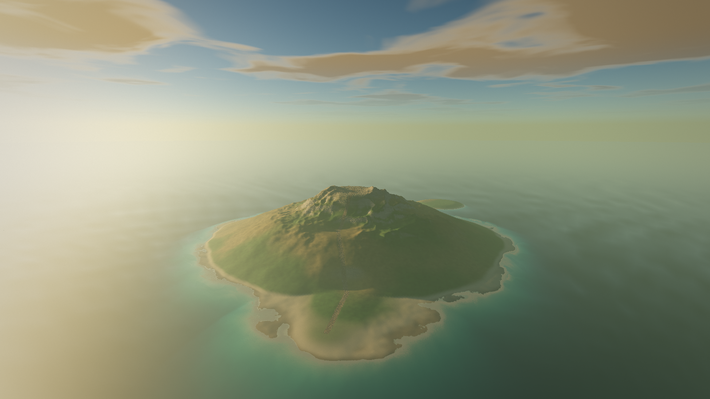

# Lanternwright

An original first-person exploration and puzzle game for macOS, in the spirit of *Myst*. Swift, with a hand-built Metal renderer and procedural everything: no engine, no asset files.

**Status:** the vertical slice, *The Isle of Varrow*, is playable end to end. Wake on a dock at golden hour, follow the lantern path past three resonance stones, read the keeper's journal, strike the stones in the right order, and walk the causeway that rises from the sea to the islet. See `docs/DESIGN.md` for the vision and `docs/TASKS.md` for the work queue (M4 polish and M5, the second world *The Glass Wood*, are done; the choice at the end of the story is not built yet).



## Play
```bash
scripts/bundle.sh && open Lanternwright.app
```
Requires macOS 15+ and the Swift toolchain (Command Line Tools are enough; Xcode is not needed).

| Control | Action |
|---|---|
| Click | capture the mouse / interact with what the ring highlights |
| W A S D (or arrows to turn) | move; **Shift** runs |
| Mouse | look |
| J | journal (← → turn pages) |
| Esc | release the mouse (opens the pause menu) / close the journal / resume |
| Ctrl-Cmd-F | full screen |
| F | send feedback (saves your note, a screenshot and where you were) |

## Developer tools
```bash
swift build -c release
.build/release/Lanternwright --selftest                      # 124 headless checks
.build/release/Lanternwright --screenshot shots/a.png --view dock --size 1600x900
.build/release/Lanternwright --screenshot shots/b.png --view dock --state solved
.build/release/Lanternwright --bench 60 --size 2560x1440      # GPU time per view
.build/release/Lanternwright --dump-audio shots/ambience.wav  # then: afplay shots/ambience.wav
.build/release/Lanternwright --dump-overlay shots/overlay     # journal / crosshair layouts
.build/release/Lanternwright --help
```
Feedback you send in-game is read back with `.build/release/Lanternwright --feedback`.

Debug views for the renderer: `--debug depth|shadow|albedo|ambient`.

## The two worlds
**The Isle of Varrow** (golden hour): solve the stones, walk the causeway, touch the floating lens. **The Glass Wood** (moonlit): a crystal forest with a mirror puzzle (set the mirrors and glass so the beam meets tide, wind, stone in order) and a chime puzzle (strike the three glass chimes that match the stones' tones, by ear). Solving both wakes the altar of two accounts. The ring beside your arrival pad takes you back. Quick-jump flags for inspecting: `--args --state solved` (Varrow solved, at the start), `--args --world glass`, `--args --state mirrors|chimes|both`. See `docs/INSPECT.md` for everything worth trying yourself.

## Settings and saves
The pause menu (Esc) has mouse sensitivity, volume, render resolution and invert-Y. Progress autosaves to `~/Library/Application Support/Lanternwright/save.json`; start fresh with `--new` or the menu's *New game…*.

## Not yet verified by a human
Mouse capture feel, the new surf and footstep/run sounds (`afplay shots/ambience.wav`), the pause menu and title screen in the real window, and whether the puzzle can be deduced without hints. Everything else is covered by the self-tests or by looking at rendered frames.
